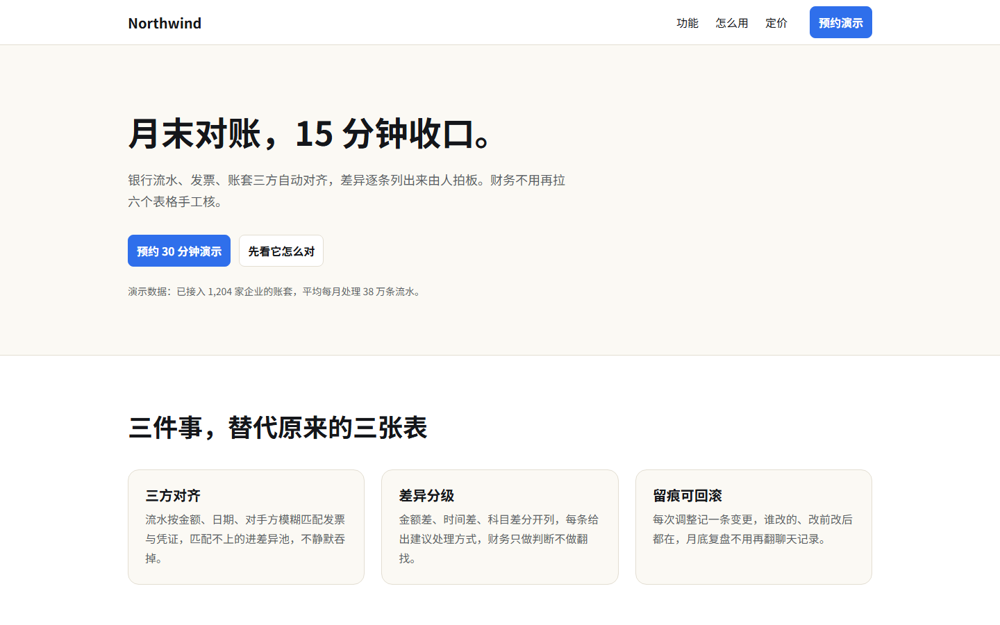
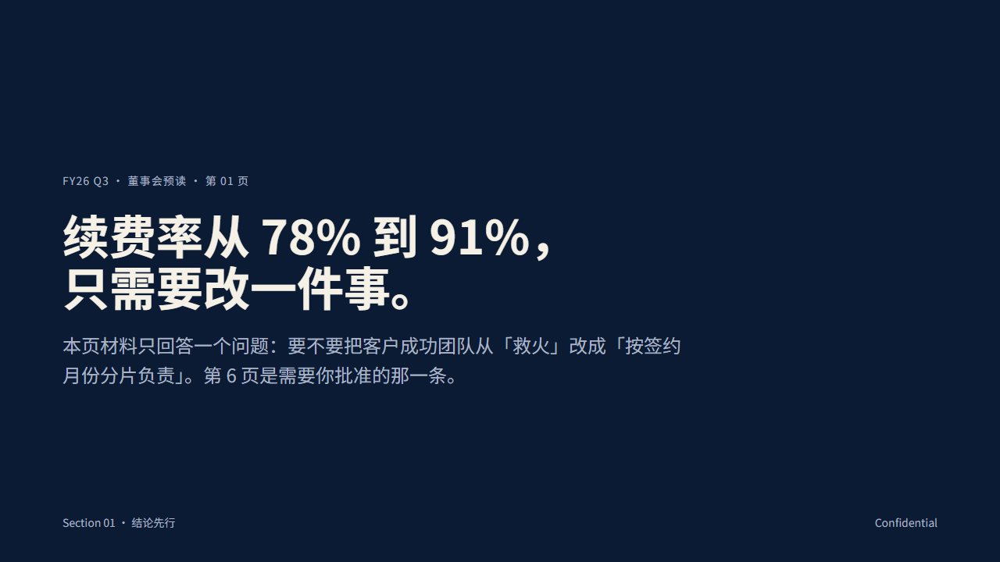
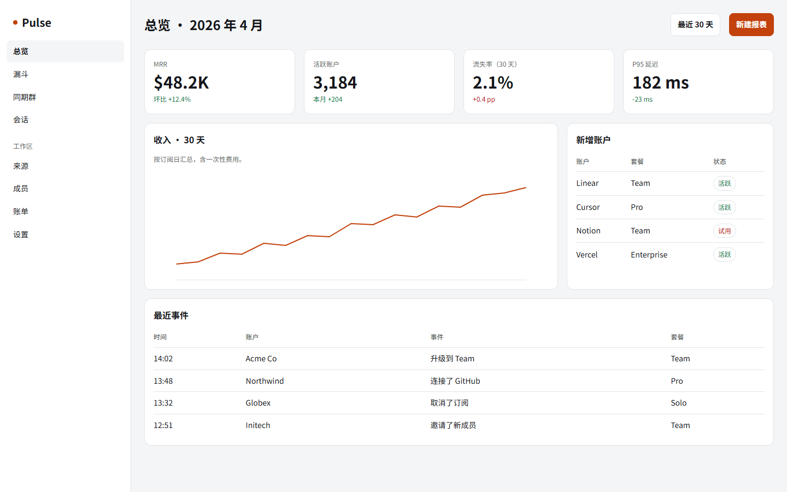

# dsh-webforge

把网页素材库变成 DSH 工具：**搜库 → 读体系 → 拼初稿 → 把 deck 打成 PDF**。

装完就能用：包内自带一个小起步库（4 模板 / 2 deck / 2 体系 / 2 技能），不依赖任何外部素材。本机装了完整库（176 模板 / 77 deck / 152 体系 / 153 技能）时自动优先用完整库。

## 安装

```bash
# 从本仓库的压缩包装（不需要 git clone）
dsh plugin --profile <你的profile> add https://codeload.github.com/1523402511/dsh-webforge/tar.gz/refs/heads/main
```

或在 DSH 的插件面板里填这个 tarball 地址。装完重启一次 DSH。

> `dsh plugin` 不能管理 Electron 独占的 `desktop` profile；那种情况下请用应用内的插件面板。

装完先自检，确认四个工具都能跑：

```bash
node tools/check.mjs --bundled
```

## 它给的是什么

| 工具 | 作用 |
|---|---|
| `webforge_search` | 搜库（按关键词 / 类型 / 就绪状态） |
| `webforge_read` | 读正文：模板 HTML、体系 `tokens.css` + `DESIGN.md`、技能 `SKILL.md`、deck 页数 |
| `webforge_build` | 模板 + 体系 + 标题 → 拼一份能打开的初稿，落盘并返回「改了什么、跳过了什么」 |
| `webforge_export` | deck / 页面按指定尺寸打成 PDF（默认 1280×720，16:9），返回页数与体积 |

外加一段系统提示：用户说「做个网页 / 官网 / 落地页 / 看板 / PPT / 演示稿」时，先搜库再动手。

**只收网页与 deck**：模板（website）、演示稿（deck）、设计体系、技能。视频动效模板（`kind: motion`，79 条 OpenDesign 动效 + 15 条 MG 风格片）不收录；技能里 16 条**视频生产类**（Sora / Kling / lip-sync / 视频模板 / 下载器 / 剪辑等）也一并摘掉。保留 `animate`（UI 动效）与 `oil-motion`（滚动、指针、拖动驱动的网页动效）；`fal-generate` 等**图像/音频生成类**保留——它们产出的是网页可用的素材（配图、朗读、背景音乐），不产出片子。

## 长什么样

起步库的落地页（`webforge_read` 读到的就是这份 HTML，`webforge_build` 会复制它再换标题与配色）：



董事会预读 deck，`webforge_export` 打出来的 PDF 首页就是这一页：



运营看板（看板类按设计规范第 2 节属信息密度优先，不套营销页留白规则）：



## 库从哪来

按优先级找，找到即用：

| 顺序 | 位置 | 说明 |
|---|---|---|
| 1 | `WEBFORGE_LIB` 环境变量 | 指向含 `vendor/open-design/catalog.json` 的目录 |
| 2 | 与本包同级的 `eac-design-world` | 同一 profile 的 `node_modules` 里装了完整库时自动命中 |
| 3 | `~/.dsh/profiles/<任意名字>/node_modules/eac-design-world` | 扫一遍所有 profile，不再写死 `desktop` |
| 4 | 包内 `library/` | 起步库，兜底，保证装完可用 |

完整库约 139 MB，来自 [OpenDesign](https://github.com/nexu-io/open-design) 的本地快照，**不随本仓库分发**（上游仓库 3.65 GB 且不带 git 快照，逐条复制会重新引入 AGPL 聚合问题）。想要完整库，自己准备一份并用 `WEBFORGE_LIB` 指过去。

起步库内容与替换规则见 [library/README.md](library/README.md)。

## 自检

```bash
node tools/validate.mjs              # 工具 schema（抓 provider 会拒收的写法）
node tools/check.mjs                 # 用本机完整库跑四个工具
node tools/check.mjs --bundled       # 用包内起步库跑，CI 用这个
node tools/check.mjs --bundled --no-export   # 没有 Edge/Chrome 的机器
```

`check.mjs` 用假 ctx 注册工具，实测「搜索 → 读取 → 拼初稿 → 导出 PDF」四条链路，产物写临时目录后自动清理。导出那步会核对 **PDF 页数 = `<section>` 数量**，不等就失败。

## 平台要求

- Node.js 20+
- 导出 PDF 需要本机 Edge 或 Chrome：Windows 的默认安装位置、macOS 的 `/Applications/*.app`、Linux PATH 里的 `google-chrome` / `chromium` 都会被找到；也可以用 `WF_BROWSER` 指定
- 默认输出目录 `~/webforge/网站`，可用 `outDir` 参数或 `WEBFORGE_OUT` 环境变量改

## 诚实边界

- `webforge_build` 产出的是**版式 + 体系的初稿**，不是成品：只换 `<title>` / meta / 首个 `<h1>`、注入 tokens、做有护栏的保守换色；不改结构、不写文案，模板自带示例数据仍在。
- 换色是启发式的：明暗极性相反、对比度不够、只出现一次的反白色值都会跳过，并在 `patches` 里写明原因。
- `brand` 只写进 `--accent` 变量，不改模板里写死的字面色值——两回事，别当成品牌换肤。
- `webforge_export` 转不出可编辑 `.pptx`：HTML deck 没有 PowerPoint 的文本框/表格语义，要可编辑只能拿版式当参考重建。
- 起步库只有 4 个模板，deck 每页固定 1280×720（会被 `fixed-width` 规则判为 reflex，属 16:9 导出的必要条件）。

## 许可

本仓库代码 MIT，起步库内容也是本仓库自写、MIT。运行时读取的完整库归上游项目所有（`nexu-io/open-design` 为 Apache-2.0，条目逐条标注 MIT / Apache-2.0 / CC-BY-4.0），本仓库不再分发它们。

## 卸载

从 profile 的依赖与 bundle 列表里移除本包，或：

```bash
dsh plugin --profile <你的profile> remove dsh-webforge
```

重启即可。插件无常驻进程、不联网。
